<p align="center">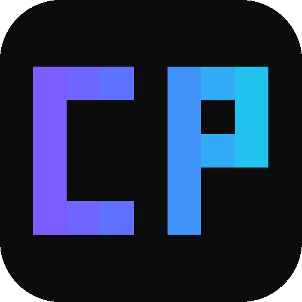</p>

<h1 align="center">CodePortal</h1>

<p align="center">A coding agent for your Windows terminal: it reads and edits your files, runs commands and searches the web for you.<br>Works with OpenAI, Anthropic, Gemini, Mistral, Groq, xAI, DeepSeek, OpenRouter, Cerebras and Poolside.</p>

<p align="center"><a href="https://github.com/Rolbubx/codeportal-cli/releases/latest">Download</a> · <a href="CHANGELOG.md">Changelog</a> · <a href="#headless-mode-and-local-api">API</a> · <a href="#agent-tools">Agent tools</a></p>

## Install

1. Download **`CodePortal-Setup-<version>.exe`** from the [latest release](https://github.com/Rolbubx/codeportal-cli/releases/latest) and run it.
2. Choose the install folder. The default, `%LOCALAPPDATA%\Programs\CodePortal`, needs no administrator rights. Then pick the options you want: add to PATH, Start Menu shortcut, desktop shortcut.
3. Open a **new** terminal in your project folder and type `codeportal`. On first launch, paste an API key.

Windows may show a SmartScreen warning because the files are not signed. Click "More info", then "Run anyway".

Prefer no installer? The release also has a portable zip (`codeportal.exe` + `web/`) and the bare `codeportal.exe`.
To uninstall, use Windows "Apps & features". Your settings and keys in `%APPDATA%\CodePortal` are kept.

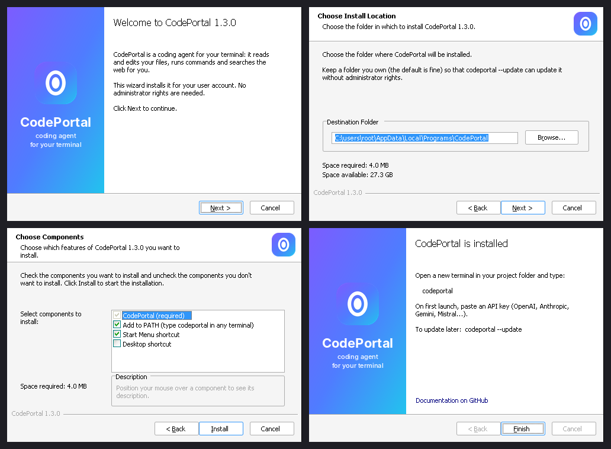

## Update

```
codeportal --update        download and install the latest version (asks first; --yes skips the question)
codeportal --check         only say whether a newer version exists
```

Inside CodePortal, `/update` does the same. `/update check` only checks, and `/update auto on|off` turns the daily check on or off.

The update downloads the new `codeportal.exe` from the latest GitHub release. It then checks the file against the release's `SHA256SUMS.txt` and refuses anything that does not match. Finally it swaps the program in place: the old version is kept as `codeportal.old.exe` until the next launch, and put back if anything fails. Once a day, CodePortal also checks in the background, without slowing anything down, and the banner tells you when a new version is out.

If CodePortal is installed in a folder you can't write to (for example `C:\Program Files`), run the update from a terminal opened as administrator.

## Screenshots

| Dark | Light |
| --- | --- |
| 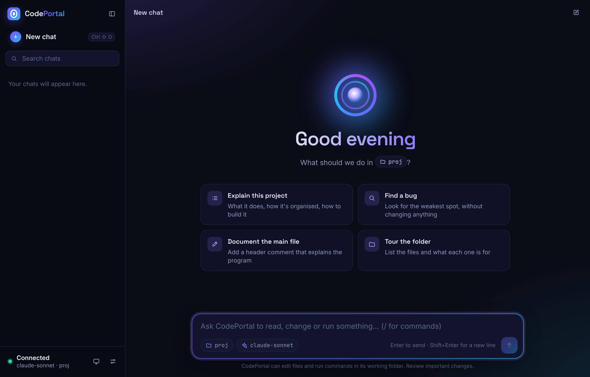 | 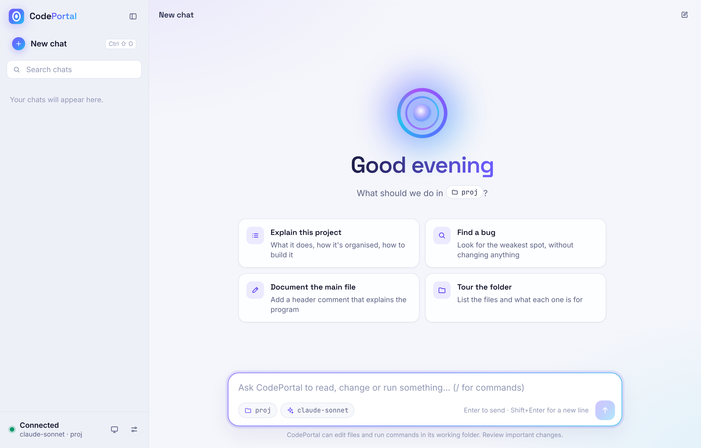 |
| 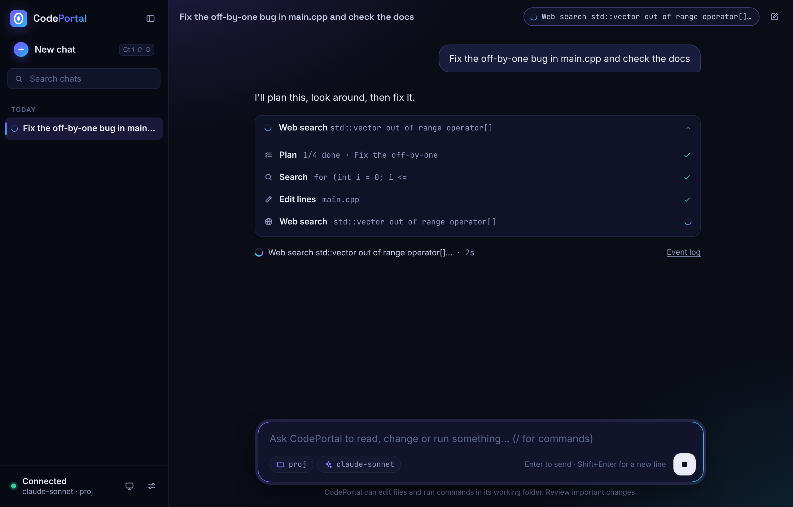 | 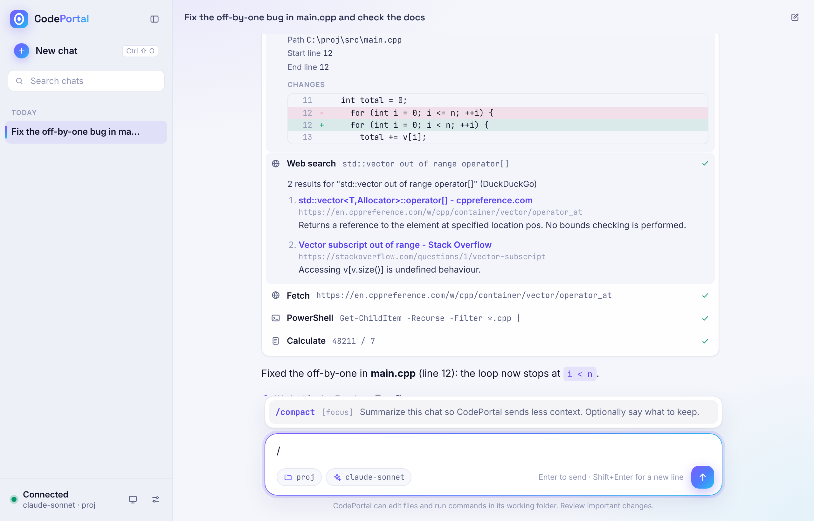 |
| 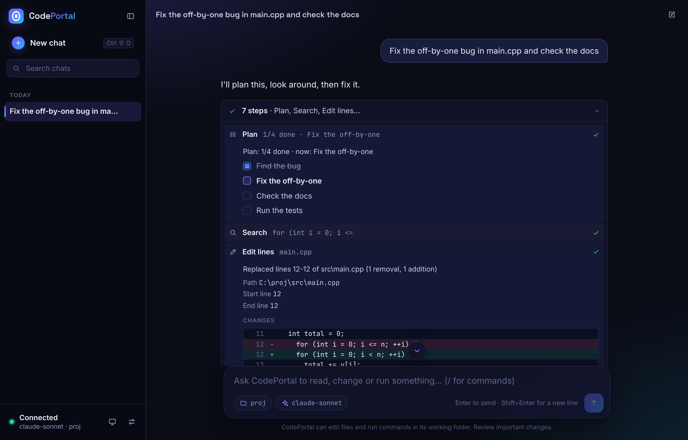 | 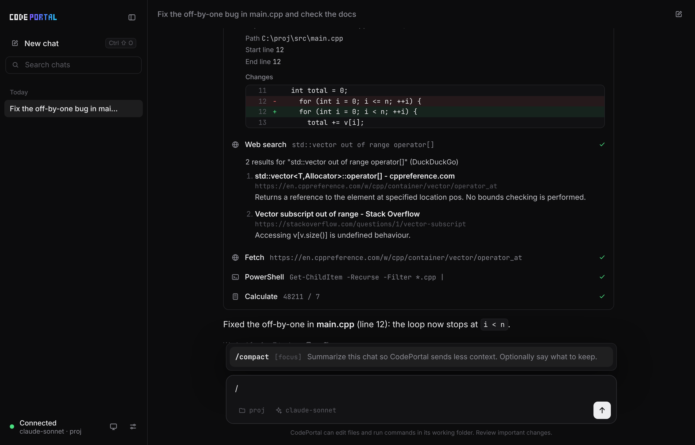 |
| 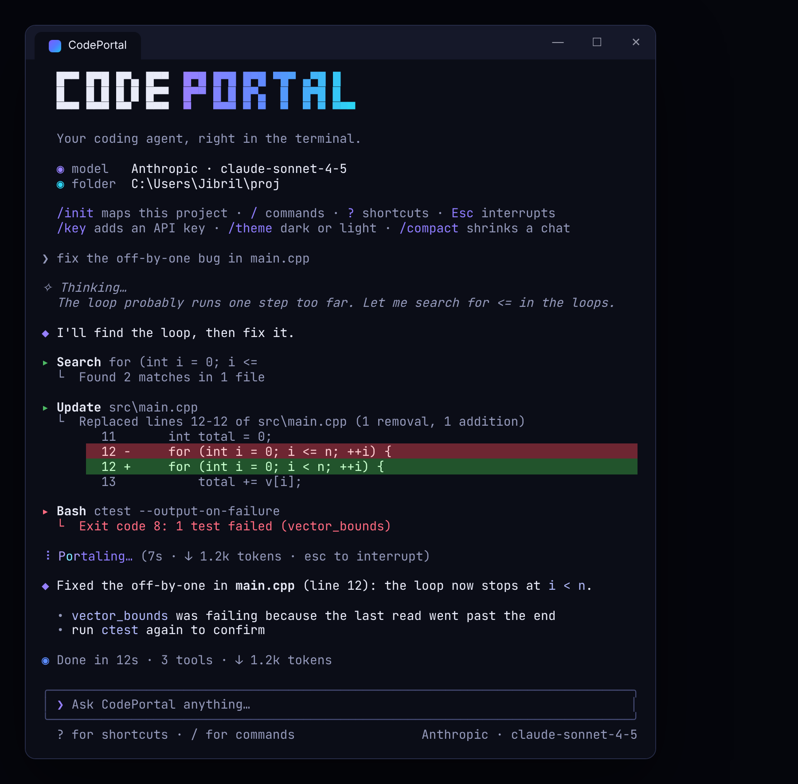 | 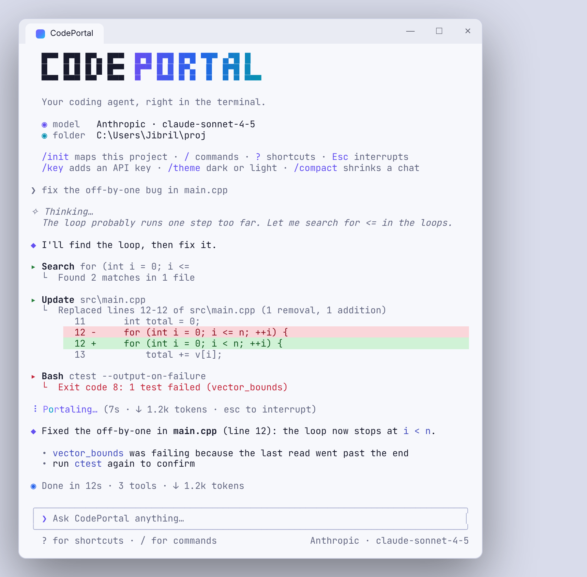 |

### On a phone

Start CodePortal with `--bind 0.0.0.0` and open `http://<your PC's address>:8765` in the phone's browser.

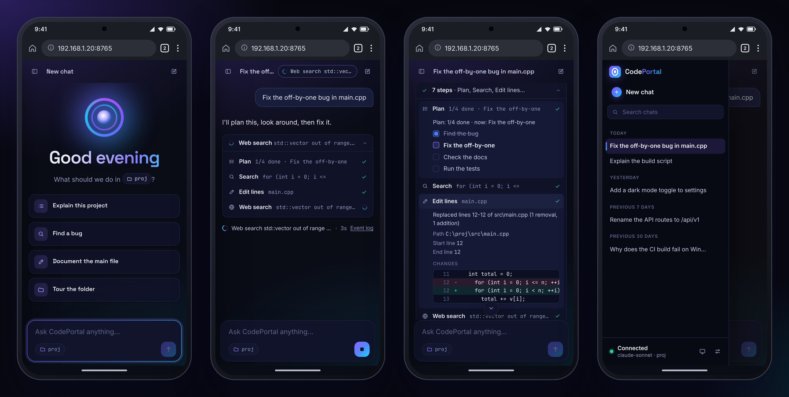

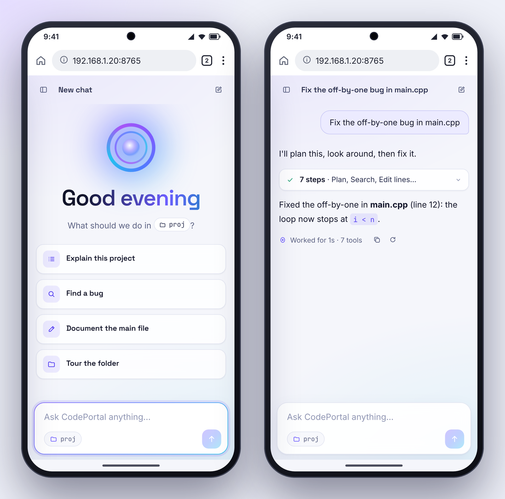

## Headless mode and local API

CodePortal can run without its console interface, as a local server that other programs call:

```
codeportal.exe --headless --port 8765
```

It listens on `127.0.0.1` by default; `--bind 0.0.0.0` makes it reachable from other computers on the network (only do this on a network you trust). On first launch it creates an access token in `%APPDATA%\CodePortal\api.token`; every request must send it as `Authorization: Bearer <token>`. An API key must already be configured (start CodePortal once interactively to add one).

| Method | Route | Body | Result |
| --- | --- | --- | --- |
| GET | `/api/v1/status` | | provider, model, working directory, `busy` |
| POST | `/api/v1/ask` | `{"message": "...", "conversation": "id"}` | `answer`, `steps` (each tool call with its arguments and result), `cancelled`. Each conversation id has its own history (default `"default"`) |
| GET | `/api/v1/events?after=N` | | live activity: numbered events (`turn_start`, `model`, `thinking`, `text`, `tool_start`, `tool_end`, `turn_end`) after N. Without `after`, starts at the latest turn |
| POST | `/api/v1/cancel` | | stops the turn in progress |
| POST | `/api/v1/reset` | `{"conversation": "id"}` | clears that conversation, or every conversation without a body |

One turn runs at a time: `ask` returns `409` while another is in progress. The agent can read and edit files and run shell commands in the working directory, so anything that holds the token can change your project. Keep the token private.

Example with curl:

```
curl -H "Authorization: Bearer $(cat "$APPDATA/CodePortal/api.token")" \
     -H "Content-Type: application/json" \
     -d '{"message":"Add a comment at the top of src/main.cpp explaining what it does"}' \
     http://127.0.0.1:8765/api/v1/ask
```

### Chat page

`CodePortal/codeportal-cli/web/codeportal-chat.html` is a chat interface for the server. Open it in a browser, enter the server address (`http://127.0.0.1:8765` by default, or the address of the computer running CodePortal) and the token from `api.token`. Each answer shows the tool calls the agent made, with their inputs and results. The page is a single file with no dependencies. CodePortal also serves it itself: at startup it prints a link such as `http://127.0.0.1:8765/#token=...`. Open that link and the page connects by itself and keeps retrying until the server is up. The token is saved in the browser and removed from the address bar.

While the agent works, the page shows what it is doing as it happens: the current phase, thinking and text as they stream, each tool call with its arguments, its diff and its result, and a raw event log. The finished turn stays in the conversation with the same details.

## Agent tools

The agent calls these tools by itself. File changes can be undone (`/undo` in the terminal, or the agent's `undo_last_change`).

| Group | Tools |
| --- | --- |
| Read and explore | `read_file` (500 lines at a time, with `start_line`), `list_dir`, `tree`, `find_files` (wildcards), `search_files` (text or regex, like grep), `file_info` |
| Change files | `create_file`, `write_file`, `edit_file` (exact replacement), `replace_lines`, `insert_lines`, `append_file`, `copy_path`, `move_path`, `delete_file`, `create_dir`, `delete_dir`, `undo_last_change` |
| Run programs | `run_command` (cmd.exe), `run_powershell`, `start_process` (background, output logged to a file), `stop_process`, `list_processes`, `wait` |
| Web | `web_search` (DuckDuckGo, then Bing; no API key), `fetch_url` (page as readable text), `download_file` |
| Windows | `open_path` (open a file, folder or website), `clipboard_read`, `clipboard_write`, `system_info`, `get_env` |
| Agent | `calculate`, `update_plan` (a checklist shown on the chat page), `save_memory` (notes kept in `%APPDATA%\CodePortal\memory.md` and given to the agent in every conversation), `get_context` |

Safety: `delete_dir` refuses drive roots, your main user folders, system folders and the working folder; `get_env` never shows values whose names look like secrets (keys, tokens, passwords).

## Building

From Windows, with the MinGW that ships with CLion: run `CodePortal\codeportal-cli\build.bat` (or use `CMakeLists.txt`). It produces `build\codeportal.exe`.

From Linux, with `g++-mingw-w64-x86-64-posix`, `nsis` and `zip` installed, run `CodePortal/codeportal-cli/scripts/build-release.sh`. It builds everything a release contains into `dist/`: the exe, the installer, the zip and `SHA256SUMS.txt`.

Every push and pull request is built by the [Build workflow](.github/workflows/ci.yml), and the files can be downloaded from the run's artifacts.

## Releasing a new version

1. Change the version in [`src/version.hpp`](CodePortal/codeportal-cli/src/version.hpp) (`CODEPORTAL_VERSION` and the three numbers).
2. Add a `## [x.y.z]` section at the top of [`CHANGELOG.md`](CHANGELOG.md).
3. Merge into `main`, then publish, either way:
   - On GitHub: **Actions → Release → Run workflow** (branch `main`). The tag `v1.4.0` is created for you.
   - Or with git:
     ```
     git tag v1.4.0
     git push origin v1.4.0
     ```

The [Release workflow](.github/workflows/release.yml) checks the version, builds everything, and publishes the release with the changelog section as its notes. From then on, `codeportal --update` finds it.
